<p align="center">
  
</p>

<h1 align="center">YatraLens</h1>

<p align="center"><strong>A context-aware travel companion for journeys across India's languages and places.</strong></p>

<p align="center">
  
  
  
  
  
</p>

<p align="center">
  <a href="#the-problem">Problem</a> · <a href="#the-solution">Solution</a> ·
  <a href="#target-users">Users</a> · <a href="#features-and-use-cases">Features</a> ·
  <a href="#architecture">Architecture</a> · <a href="#run-locally">Run locally</a>
</p>

> **Project stage:** Working local development prototype. The [master PRD](YATRALENS_MASTER_PRD.md) defines the complete F01–F13 product; [implementation status](IMPLEMENTATION_STATUS.md) records phone-tested behavior and unfinished acceptance gates. The prototype is not a production travel or safety service.

## The problem

Crossing a state border can make ordinary travel decisions difficult: Which bus is mine? What does a Malayalam board say? How do I ask the conductor or auto driver? Where is my boarding jetty? Did the operator change the time? Camera search, translation and maps help with individual questions, but the traveller still carries the journey's context between them and decides which answer to trust.

The Alappuzha pilot starts with a real traveller's experience of struggling with bus boards, conversations, food and shop names, and locating the final destination. A confident but unsupported route or boarding claim can be worse than an honest request to confirm with a local person.

## The solution

**YatraLens connects physical observations to an active trip.** A user-started Android session brings together permitted camera and microphone input, location and motion, time, weather, saved destinations and source-linked trip memory. It can read a sign, help two people speak across languages, compare new information with earlier evidence, and suggest a useful next question or action.

```text
Observe with permission → interpret → attach source and time → compare with trip context
→ explain uncertainty → help the traveller act → remember what they approve
```

The goal is to answer: **“Given where I am, what I can see or hear, and what I am trying to do, what should I do next?”** The product's intended value is the connected, evidence-aware journey. OCR, translation, maps and voice AI are existing capabilities that YatraLens brings into that workflow.

Its **Physical Context Engine** maintains the trip situation and actual sensor health. “24/7” means an available, recoverable trip session, not uninterrupted camera or microphone capture. Android lifecycle, permissions, heat and battery can interrupt sensing; the app must show the real state.

## Target users

| User | Need |
| --- | --- |
| Regional Indian traveller | Understand signs and conversations in an unfamiliar language while moving through a real trip. |
| Family or group traveller | Keep boarding points, times, quotes and weather-sensitive plans together. |
| Traveller with low vision or reading difficulty | Larger controls, speech output and help reading signs. YatraLens is not a certified mobility aid. |
| Local operator or vendor | Communicate with visitors without depending on English; speech capture and retention require notice and consent. |
| Tourism or community partner | Contribute sourced local information without fabricated listings or hidden ranking. |

## A journey through Alappuzha

1. **Find the bus.** The traveller selects a destination and scans a Malayalam board. YatraLens shows the recognized text and source image. If the available reference cannot confirm the route, it prepares a Malayalam question for the conductor.
2. **Talk to someone nearby.** The traveller asks in Telugu or English; the local person replies in Malayalam. Each side can review translated text before speech playback or saving.
3. **Find the right place.** A saved jetty or accommodation point is compared with a fresh GPS fix, with accuracy shown. The traveller can open a map.
4. **Remember the detail.** A fare or boarding time becomes a proposed claim linked to consented conversation evidence. The traveller reviews it before relying on it.
5. **Handle a change.** If a later statement disagrees with a booking, YatraLens shows both sources and asks for clarification before giving a definitive reminder.
6. **Adapt to conditions.** A forecast overlapping a boat ride can prompt an operator check. A forecast is never presented as an official cancellation.

## Features and use cases

These are the thirteen PRD feature groups. **Prototype** means a connected implementation path exists; it does not mean field reliability or every PRD acceptance test is complete. See [implementation status](IMPLEMENTATION_STATUS.md) for current evidence.

| Feature | Use-case scenario | State |
| --- | --- | --- |
| **F01 · Point & Ask** | Point at a jetty and ask what the camera can identify. | Prototype: CameraX and on-device Mirage scene cues; exact boarding guidance needs field validation. |
| **F02 · Talk & Listen** | Ask a Malayalam boat operator about fare and return time in Telugu. | Prototype: two-way speech/translation tested with a synthetic operator turn; fluent-human review remains. |
| **F03 · Read Anything** | Photograph a Malayalam bus board or notice and hear an explanation. | Prototype: selected crop, Indic OCR, translation and review; street-sign accuracy is unbenchmarked. |
| **F04 · Geospatial Intelligence** | Check whether the current location matches a saved booking jetty. | Prototype: accuracy-aware distance/bearing and map handoff; real booking-point check remains. |
| **F05 · Weather-Aware Guide** | Check a planned boat ride against forecasts and available warnings. | Prototype: sourced Open-Meteo assessment and Kerala warning lookup; live alert needs validation. |
| **F06 · Smart Transport** | Scan a bus destination and ask whether it may serve the intended stop. | Prototype: source-aware `MATCH`/`NO_MATCH`/`UNKNOWN` and pinned community reference; no live timetable guarantee. |
| **F07 · Cultural Companion** | Ask about a nearby temple's known history or visitor information. | Prototype: source-linked pilot lookup; visual site identity and wider coverage are limited. |
| **F08 · Trip Memory** | Ask later, “What fare and boarding time did the operator say?” | Prototype: local evidence, provisional claims, timeline and deletion; live agreement review needs a full check. |
| **F09 · Evidence & Conflicts** | Booking says 15:30; a later conversation suggests 16:00. | Prototype: conflict cards and user resolution; full live disagreement flow remains. |
| **F10 · Accessibility** | Use large actions and spoken results to read a sign. | Partial: labels and controls exist; TalkBack, scaling and contrast audits remain. |
| **F11 · Offline Assistance** | Lose data and retrieve saved phrases, destination and trip evidence. | Partial: local memory, phrasebook and emergency references; offline ASR and maps remain future work. |
| **F12 · Local Discovery** | Find a sourced coir craft experience or nearby operator. | Prototype: small Alappuzha pilot; merchant coverage and live availability are limited. |
| **F13 · Physical Context Engine** | Keep an authorized trip available as location, weather and agreements change. | Prototype: foreground sensing, sensor state and alert policy; endurance and recovery checks remain. |

## How Sarvam powers the features

Sarvam supplies **Indian-language and document AI through the consent-gated backend**. It is a family of specialized models, not one model that sees the whole trip. YatraLens supplies the camera and GPS observations, the local trip memory, source checks, conflict rules and user controls. The backend sends only the selected input needed for an approved cloud action; the Sarvam API key stays off the phone.

| Sarvam capability | What the model does | Where YatraLens uses it |
| --- | --- | --- |
| [**Saaras v4**](https://docs.sarvam.ai/api/api-guides-tutorials/models/saaras) · `saaras:v4` | Converts speech to text, including Indian languages and code-mixed speech. Its output modes include original-language transcription, English translation and Romanized text. | **F02, F08:** transcribe a selected traveller or local-person turn before translation or optional evidence review. Saaras alone does not perform the full two-way conversation. |
| [**Sarvam Translate**](https://docs.sarvam.ai/api/api-guides-tutorials/models/sarvam-translate) · `sarvam-translate:v1` | Translates text across English and 22 Indian languages in a primarily formal style. | **F02, F03, F06:** translate a reviewed transcript, recognized sign text or conductor question. Preserve names, prices and times for human checking. |
| [**Mayura**](https://docs.sarvam.ai/api/api-guides-tutorials/models/mayura) · `mayura:v1` | Offers conversational translation and control over style and output script for its supported languages. | **F02, F06:** used by the backend when an output script is requested. It is a selected path, not the default for every translation. |
| [**Bulbul**](https://docs.sarvam.ai/api/api-guides-tutorials/models/bulbul) · `bulbul:v3` / `bulbul:v4-flash` | Turns text into spoken audio. | **F01–F03, F06, F07, F10:** play a reviewed explanation or translation. The current backend selects **v3 for Malayalam** and **v4 Flash for other configured languages**; voice quality still needs listening tests. |
| [**Sarvam Vision / Document AI**](https://docs.sarvam.ai/api/api-guides-tutorials/models/sarvam-vision) | Extracts Indian-language text and structure from document-like images and scans. | **F03, F06:** fallback OCR when OpenAI vision cannot read a user-approved crop. A moving bus board or street sign still needs real-photo accuracy testing. |
| [**Sarvam 105B**](https://docs.sarvam.ai/api/token-factory/models/sarvam-105b) · `sarvam-105b` | Produces text responses and structured plans from supplied text context. | **F01–F13 assistant entry:** proposes a bounded task from the traveller's request; Android still decides whether to activate a sensor or share data. The backend also uses it for selected code-mixed translation cases. It does not verify a bus route or a booking by itself. |

**Example language path:** A traveller approves a spoken Telugu question → Saaras transcribes it → Sarvam Translate or a selected Mayura path produces Malayalam text → the traveller reviews it → Bulbul speaks it. A Malayalam reply follows the reverse path. If the traveller approves saving a fare or time, YatraLens stores the transcript as local evidence and checks it against existing trip claims. The language models do not turn a quote into a confirmed booking.

[Sarvam Voice Agents](https://docs.sarvam.ai/voice-agents/overview) is a separate platform that can orchestrate speech, reasoning and telephony. **Outbound AI calling is not part of the current YatraLens prototype**; it would need its own setup, consent flow and live-call validation.

## How camera understanding works

For approved image tasks, the backend sends **one selected frame to OpenAI vision first**. This is the primary camera path for scene questions and camera-led cultural questions; it is also the first OCR path for signs and bus boards. A visible landmark name is used for a sourced history lookup only when it appears in the model's visible-text output. A nearby Google Places result remains a candidate until the sign or traveller confirms it. The OpenAI key stays on the backend; the app shows the captured image used for its answer. [OpenAI vision documentation](https://developers.openai.com/api/docs/guides/images-vision?api-mode=chat).

If cloud vision fails, the app can use on-device Mirage scene cues; text crops can use Sarvam Document AI OCR. These are fallback paths, and their observations are shown with uncertainty.

[Mirage](https://huggingface.co/Cactus-Compute/mirage) is the image-understanding model bundled in the ARM64 Android build and run through the Cactus runtime. For a **user-selected camera capture**, it returns structured scene, object, text and relationship cues on the phone. YatraLens can use those cues in **F01 Point & Ask** when OpenAI vision is unavailable. This local scene step does not require uploading the photo. The **F06 Smart Transport** bus-board flow uses a separate OCR crop and source-aware route check.

Mirage's cues are **observations, not proof** of an exact boarding gate, bus route, landmark identity or safe path. The app checks whether a capture is recent and asks the traveller to confirm consequential details. Malayalam sign reading uses the separate, consented Indic OCR path; Mirage's general scene-text output is not presented as validated Malayalam OCR. The bundled files, hashes and licenses are recorded in [third-party model provenance](THIRD_PARTY_MODELS.md).

## Screenshots and demo video

These are real captures from the Android phone. The conversation screen uses a **synthetic typed Malayalam local reply**; it is not a recording of a local person.

| Home and trip | Sign scan | Two-sided conversation | Trip memory |
| :---: | :---: | :---: | :---: |
| 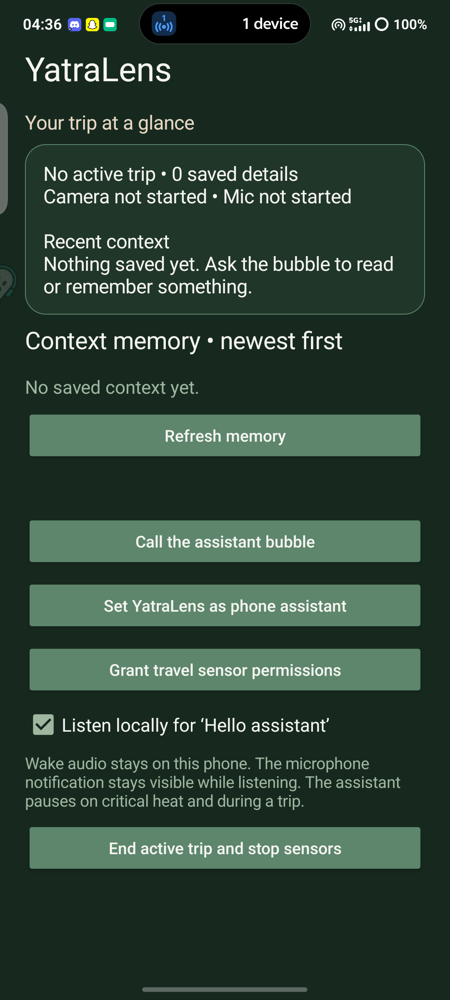 | 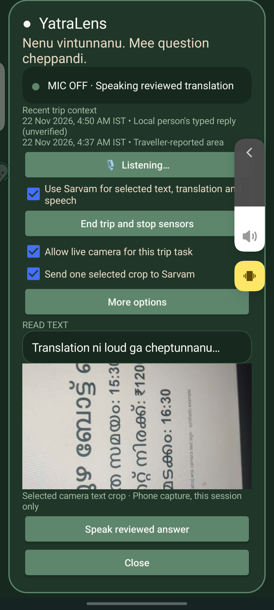 | 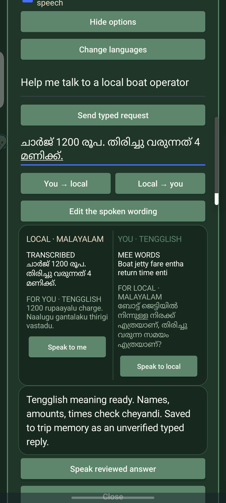 | 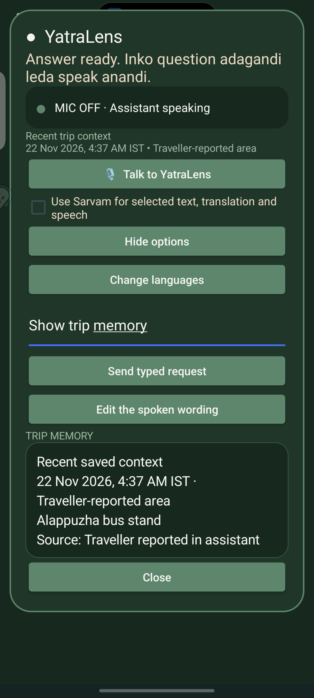 |
| [Home](docs/screenshots/home.png) | [Sign scan](docs/screenshots/sign-scan.png) | [Conversation](docs/screenshots/conversation.png) | [Memory](docs/screenshots/memory.png) |

| Camera temple | Current weather | Bus options | Saved booking |
| :---: | :---: | :---: | :---: |
| 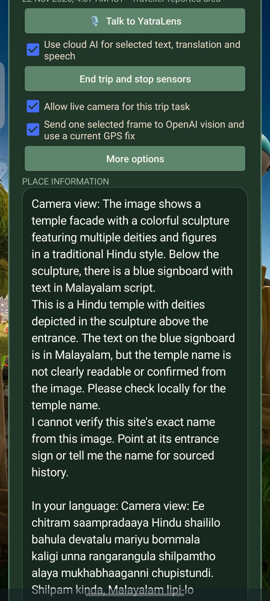 | 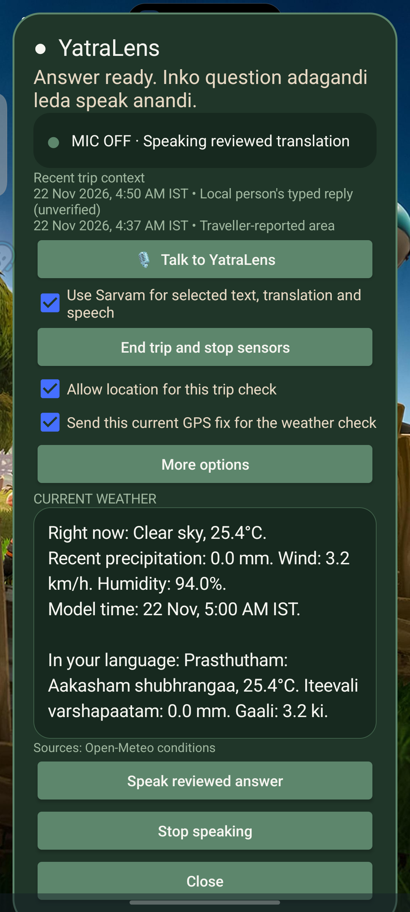 | 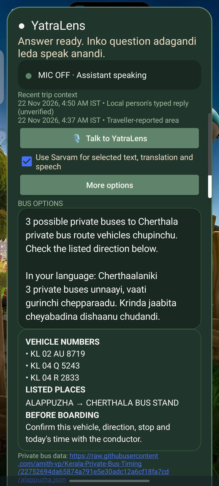 | 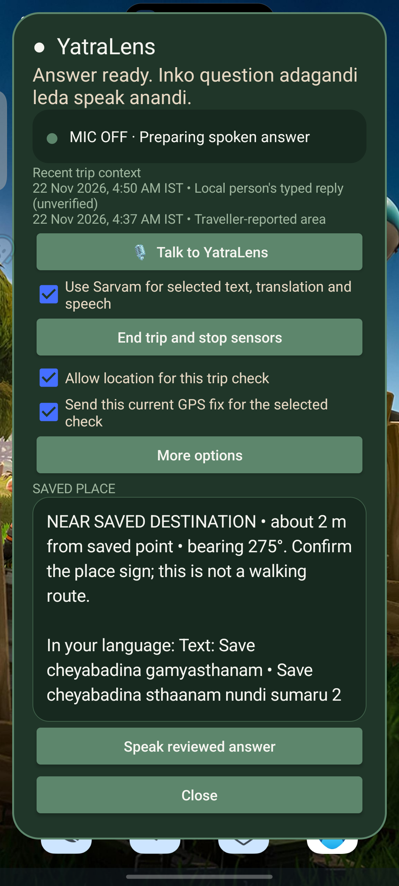 |
| [Camera result](docs/screenshots/camera-temple.png) | [Weather](docs/screenshots/weather.png) | [Bus options](docs/screenshots/bus-options.png) | [Booking](docs/screenshots/booking.png) |

**[Prototype demo video](docs/demo/YatraLens-prototype-demo.mp4)** (3–4 minutes): recorded phone flows with chapter cards covering F01–F13. The cards explicitly identify paths that have not passed a full live check. The local-person Malayalam turn is synthetic typed input; the app translates and speaks both sides.

## Tech stack

| Layer | Technology in this repository | Role |
| --- | --- | --- |
| Android app | Kotlin, Android Views, Gradle Kotlin DSL, Android SDK 36 | Home, assistant bubble, trip UI and consent controls. |
| Sensing | CameraX, `AudioRecord`, Android location and motion/system sensors, foreground service | Permissioned observations and truthful sensor state. |
| On-device AI | Cactus/Mirage via JNI; bundled Vosk wake model | Local scene cues and opt-in English “Hello assistant” wake pilot. Live wake reliability is unverified. |
| Local memory | Android `SQLiteOpenHelper` | Trips, destinations, evidence, claims, conflicts and timeline. |
| Backend | Python, FastAPI, Pydantic, Uvicorn, HTTPX | Local API bridge, validation, policies and provider calls. |
| Indian-language AI | Sarvam Saaras, translation, Bulbul, 105B and document OCR | Consented speech, translation, synthesis, planning and selected-crop OCR. |
| External data | Open-Meteo, public IMD Kerala warning page, curated sources, community bus reference | Weather, culture, discovery and cautious transport candidates. |
| Verification | pytest, JUnit, Android instrumentation | Policy, backend and selected device checks. |

See [third-party model provenance](THIRD_PARTY_MODELS.md), [bus-data limitations](docs/bus-data.md) and the [local wake pilot](docs/local-wake.md).

## Architecture

This diagram reflects the **current prototype's main boundaries**. The [PRD](YATRALENS_MASTER_PRD.md) describes the intended full system separately.

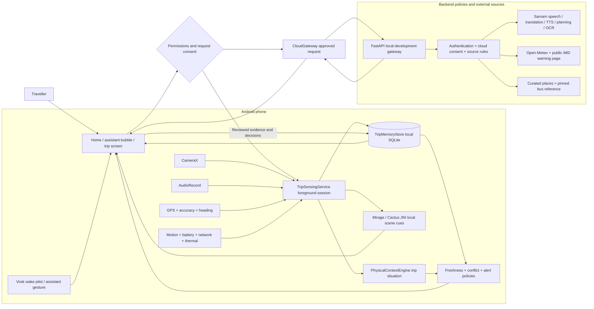

**Trust boundary:** Trip memory stays on the phone. Selected image crops, spoken turns, typed text or location reach the backend for an approved feature. The Sarvam key stays on the backend. Today's debug APK uses a disposable token and ADB reverse to a loopback server; it is not a production deployment.

### Sequence: read a sign and check a bus

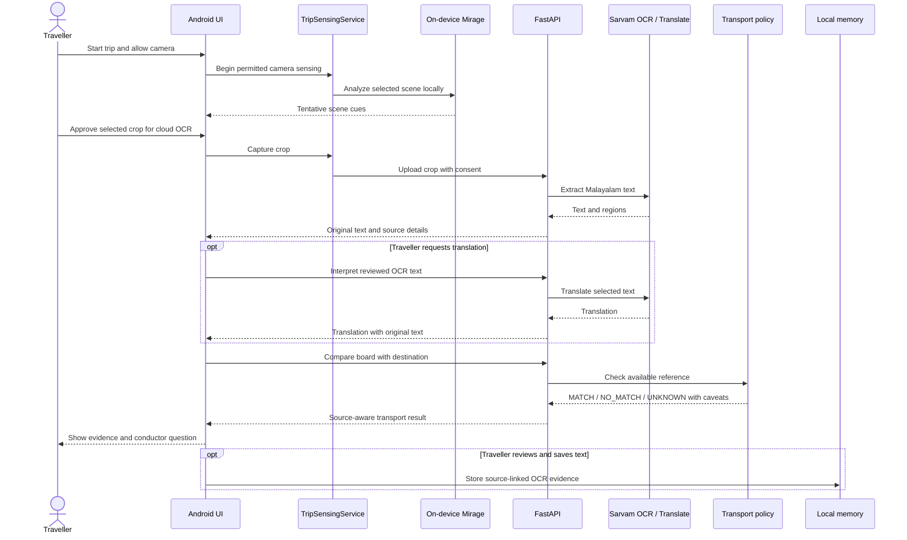

### Sequence: communicate, remember and resolve a changed time

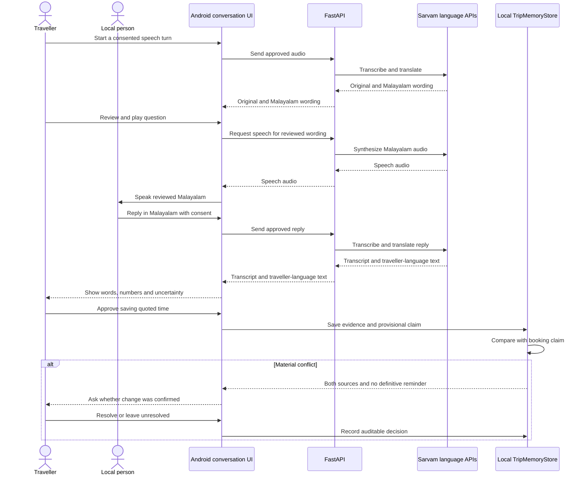

### Sequence: assess weather against a plan

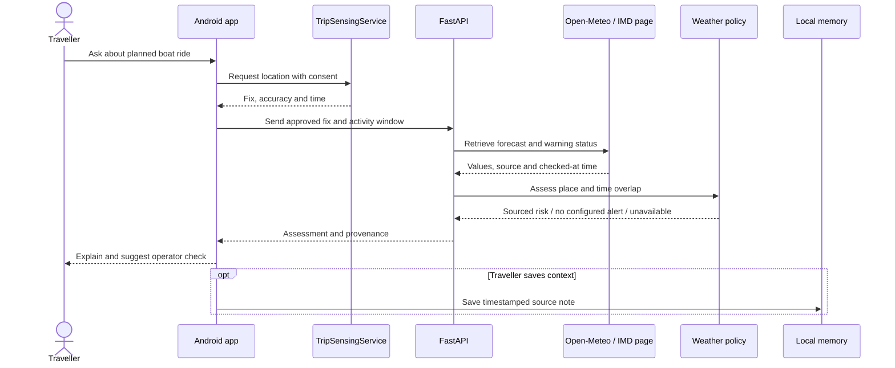

### Repository map

```text
android/                 Native Android app, on-device models and device tests
  app/src/main/java/com/yatralens/
backend/app/             FastAPI gateway, provider calls and decision policies
backend/tests/           Backend policy and API tests
docs/bus-data.md         Community transport reference and its limitations
docs/local-wake.md       Wake-phrase pilot and its validation status
THIRD_PARTY_MODELS.md    Bundled model provenance
YATRALENS_MASTER_PRD.md  Full product contract and acceptance scenarios
IMPLEMENTATION_STATUS.md Current tested behavior and open gates
```

## Run locally

**Prerequisites:** ARM64 Android 10+ phone with USB debugging; Android SDK 36, NDK `27.1.12297006`, CMake and JDK 17; Python 3.12 or compatible Python 3. A Sarvam key is needed for cloud language features. Test real sensing on a physical phone.

From the repository root, start the backend:

```powershell
Copy-Item .env.example .env
# Edit .env: add OPENAI_API_KEY for primary camera analysis, SARVAM_API_KEY for
# language/OCR fallback, GOOGLE_MAPS_API_KEY for nearby places, and a disposable
# YATRALENS_DEV_TOKEN.
python -m pip install -r backend/requirements.txt
python -m uvicorn backend.app.main:app --host 127.0.0.1 --port 8000
```

In another terminal, connect and install the app:

```powershell
adb reverse tcp:8000 tcp:8000
Set-Location android
.\gradlew.bat :app:assembleDebug
adb install -r app/build/outputs/apk/debug/app-debug.apk
```

The debug build reads `YATRALENS_DEV_TOKEN` from `.env` at build time. Keep it disposable. **Never put provider keys in the APK or commit `.env`.** See [current setup notes](IMPLEMENTATION_STATUS.md#run-locally).

### Checks

```powershell
python -m pytest -q backend/tests
Set-Location android
.\gradlew.bat :app:assembleDebug
.\gradlew.bat :app:connectedDebugAndroidTest  # Connected phone required
```

## Privacy and reliability limits

- Camera, microphone and location use require Android permissions and user-started controls. Cloud requests have separate consent. Raw audio and camera frames are not retained by default.
- A transcript or OCR result can be wrong. Review money, times, place names and agreements; an operator quote is not a confirmed booking.
- Community transport references may be historical. Forecasts cannot prove that a boat is operating or safe.
- Production sign-in, HTTPS deployment, certified emergency/mobility guidance, long-running battery/thermal performance and lifecycle recovery are not complete. See [implementation status](IMPLEMENTATION_STATUS.md).

## Future directions

1. Validate an end-to-end Alappuzha journey with real Malayalam signs, fluent speakers and dated transport evidence.
2. Complete TalkBack, large-text, contrast and low-vision interaction testing.
3. Improve offline speech, downloadable maps and recovery without a network.
4. Measure 30-minute-plus sensing, heat, battery and Android lifecycle recovery across devices.
5. Add production authentication, HTTPS and documented data/provider retention controls.
6. Expand curated local information and language-pair evaluations beyond Kerala.

## Contributing and license

Issues and focused pull requests are useful for reproducible Android bugs, permissioned sign samples, accessibility feedback and source-backed transport corrections. Read the [PRD](YATRALENS_MASTER_PRD.md), [implementation status](IMPLEMENTATION_STATUS.md) and [model provenance](THIRD_PARTY_MODELS.md) first. Do not submit API keys or private trip data; label synthetic fixtures clearly.

**License status:** There is no top-level `LICENSE` file yet. The code is not currently offered under an open-source license; the owner must choose and add one before reuse or redistribution terms are established. Bundled third-party models and data retain their own terms.
